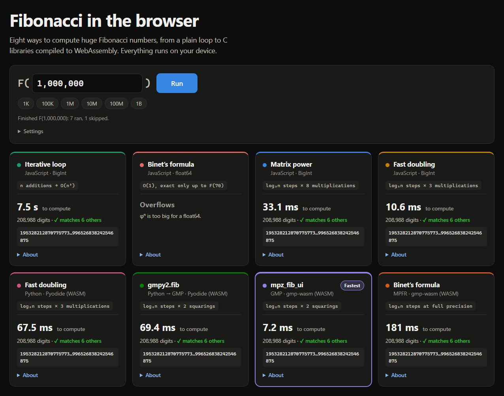
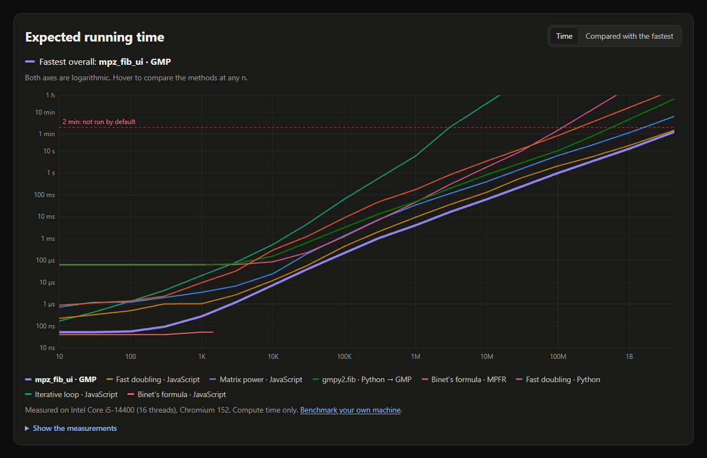

# FibonacciTestingWASM

This project is a simple web-based tool to compare the performance of different Fibonacci number calculation
methods, with a focus on WebAssembly (WASM) and Python in the browser. It shows different, interesting ways of
calculating very large Fibonacci numbers, and the benefits of running WASM in the browser.

The results show how WASM can be very beneficial, and much faster, in specific cases: GMP, a C library for huge
numbers, compiled to WASM beats every other method here, including JavaScript's built-in `BigInt`. It isn't hard to
set up either: calling GMP from JavaScript takes a few lines (see [`js/algorithms.js`](js/algorithms.js)), and you're
free to take any code from this repo for your own experiments.

**Live demo: https://m-minkov.github.io/FibonacciTestingWASM/**

<p align="center"></p>

## Results

<p align="center"></p>

**The fastest method is `mpz_fib_ui`: GMP compiled to WASM.** Time to compute F(n) on an Intel Core i5-14400 in
Chromium 152:

| Method | Runs on | F(10⁶), 208,988 digits | F(10⁸), 20.9 million digits |
|---|---|---|---|
| **`mpz_fib_ui`** | **GMP, compiled to WASM** | **4.0 ms** | **0.99 s** |
| Fast doubling | JavaScript `BigInt` | 9.4 ms | 2.1 s |
| Matrix power | JavaScript `BigInt` | 34 ms | 6.3 s |
| `gmpy2.fib` | Python calling GMP, on Pyodide (WASM) | 49 ms | 10.5 s |
| Binet's formula | MPFR, compiled to WASM | 174 ms | 51 s |
| Fast doubling | Pure Python, on Pyodide (WASM) | 45 ms | 91 s |
| Iterative loop | JavaScript `BigInt` | 5.9 s | not run (about 2 days) |
| Binet's formula | JavaScript float64 | overflows | overflows |

What this shows:

- **WASM brings faster libraries to the browser.** JavaScript's `BigInt` is already fast, but GMP has been tuned for
  big-number math for decades. Compiled to WASM, it is about 2× faster than `BigInt` running the best algorithm.
- **How the WASM is built matters.** `gmpy2.fib` calls the very same GMP function, but Pyodide's copy of GMP is built
  without GMP's usual optimizations, so it is about 10× slower than gmp-wasm's.
- **Python in WASM is still Python.** Pure Python's integers stop at Karatsuba multiplication, so it falls further
  behind as n grows: 11× slower than GMP at F(10⁶), 90× at F(10⁸).
- **The algorithm matters most of all.** The basic loop does n additions on ever-larger numbers (O(n²)). Every other
  method needs only about log₂ n steps.

## The methods

| Method | How it works |
|---|---|
| Iterative loop | Add the last two numbers, n times. |
| Binet's formula (float64) | Round φⁿ/√5 using ordinary floats. Exact only up to F(70). |
| Matrix power | Raise [[1,1],[1,0]] to the n-th power by repeated squaring: log₂ n steps × 8 multiplications. |
| Fast doubling | Jump from F(k), F(k+1) to F(2k), F(2k+1): log₂ n steps × 3 multiplications. |
| `mpz_fib_ui` and `gmpy2.fib` | GMP's own Fibonacci function: doubling with 2 squarings per step. |
| Binet's formula (MPFR) | φⁿ/√5 with about 0.69n bits of precision, so the rounded result is exact. |

Every method runs in its own Web Worker, so the page never freezes. Runs expected to take over 2 minutes or about
1.5 GB of memory are skipped unless you turn on dangerous mode.

## Running locally

Workers and ES modules need a web server (opening `index.html` as a file won't work):

```bash
python -m http.server 8000
```

Then open http://localhost:8000. There's no build step and nothing to install.

## How the code is organized

- [`js/algorithms.js`](js/algorithms.js): the implementations. The page shows this exact code under each method's "About".
- [`js/worker.js`](js/worker.js): one worker per method; loads Pyodide or gmp-wasm only when needed.
- [`js/engine.js`](js/engine.js): method details, the worker wrapper and the time and memory estimates.
- [`js/app.js`](js/app.js): the page: running methods side by side, progress bars and the chart.
- [`bench.html`](bench.html): measures your own machine and regenerates [`js/bench-data.js`](js/bench-data.js),
  the data behind the chart. Past the largest measured size, the chart follows the measured trend.

## License

Released into the public domain under [the Unlicense](LICENSE). Copy, change, sell or use any of it however you
like, with no need to credit anyone. The one exception is the bundled gmp-wasm library in
[`js/vendor/`](js/vendor/), which keeps its own LGPL-3.0 license (see [`js/vendor/README.md`](js/vendor/README.md)).

## Credits

- Fast doubling and matrix derivations: [Project Nayuki](https://www.nayuki.io/page/fast-fibonacci-algorithms)
- [GMP](https://gmplib.org/) and [MPFR](https://www.mpfr.org/), compiled to WASM by [gmp-wasm](https://github.com/Daninet/gmp-wasm)
- [Pyodide](https://pyodide.org/) and [gmpy2](https://github.com/gmpy2/gmpy2)
